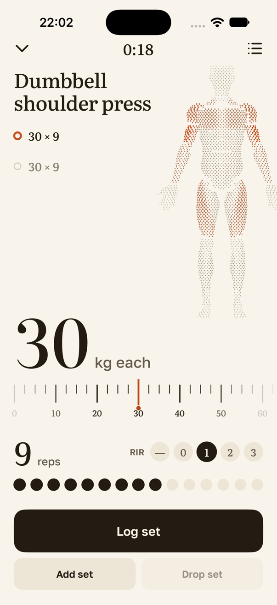
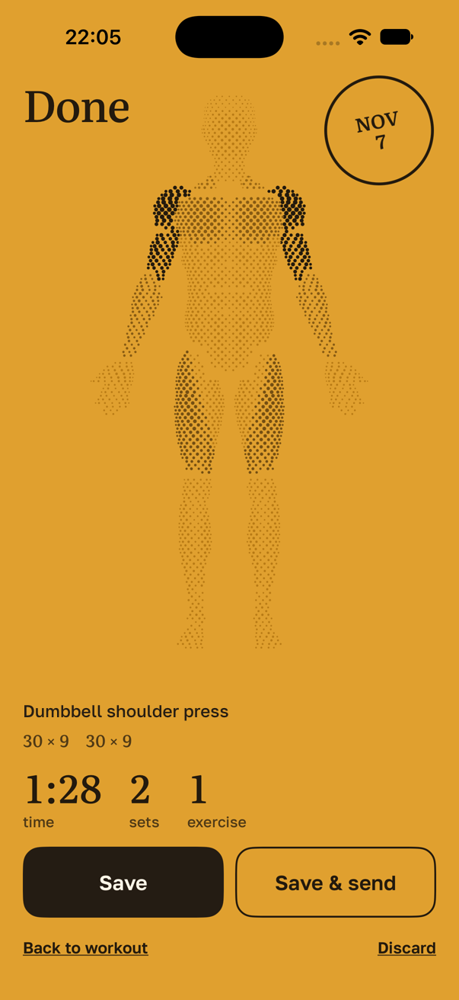

# LiftLog

LiftLog is a native strength-training diary for iPhone. During a workout you set the weight on a ruler, tap out the reps and press **Log set**. A dot flies to the muscle that set worked. When you finish, the diary stamps the page with the date.

[Watch the promo](https://nikitovih2004-ui.github.io/liftlog-showcase/) · 25 seconds, with sound · [download the MP4](https://github.com/nikitovih2004-ui/liftlog-showcase/releases/download/v1.0-showcase/liftlog.mp4). The video recreates the interface with HTML animation. The two screenshots below are of the app itself, taken in the iPhone simulator in demo mode.

| Logging a set | Finishing a workout |
| --- | --- |
|  |  |

The exercise name in the screenshots and film has been translated as “Dumbbell shoulder press” for this edition.

## How it works

- **During a workout** the app keeps a list of sets. You can correct the weight and reps, and undo the last action.
- **Afterwards** the calendar shows which days you trained, and Progress follows the working weight of each exercise over time.
- **In the code** SwiftUI handles the screens. A separate package, LiftLogCore, holds the diary model, the calculations and local storage. A workout stays saved on the device until it is sent.
- **The figure** is drawn by Metal from thousands of dots, each with its own position, radius and color. The fragment shader smooths the edge of every circle, so the figure keeps its halftone look as it turns. [Shader source](code/BodyDotsShader.swift)

## How it was built

| Stage | What was done |
| --- | --- |
| Prototype | A web prototype set the proportions of the journal page and tested whether a ruler and rep dots make logging a set easy. |
| Native interface | The screens moved to SwiftUI and the figure to Metal. Tests checked the Swift formulas against the prototype's JavaScript. |
| Diary | The screens were connected to a shared data model, with a local cache and a queue of saved workouts. |
| Polishing on the iPhone | Testing on the device led to undo and editing for sets, exact keyboard entry, and progress over different periods. |

The author set the tasks, decided how the interface should behave and tested it on an iPhone. Claude and GPT helped write and review the code.

## Credits

Music in the promo: an excerpt of *Happy Beats / Business Moves Vol. 12* by Sascha Ende, mixed with sound effects by Kenney. [Sascha Ende](https://ende.app/) · [CC BY 4.0](https://creativecommons.org/licenses/by/4.0/) · [Kenney](https://kenney.nl/)

The muscle outlines for the figure are based on react-native-body-highlighter, © 2022 ELABBASSI Hicham. The interface uses the Literata and Golos Text typefaces. [Outline license](credits/body-outlines.txt)
