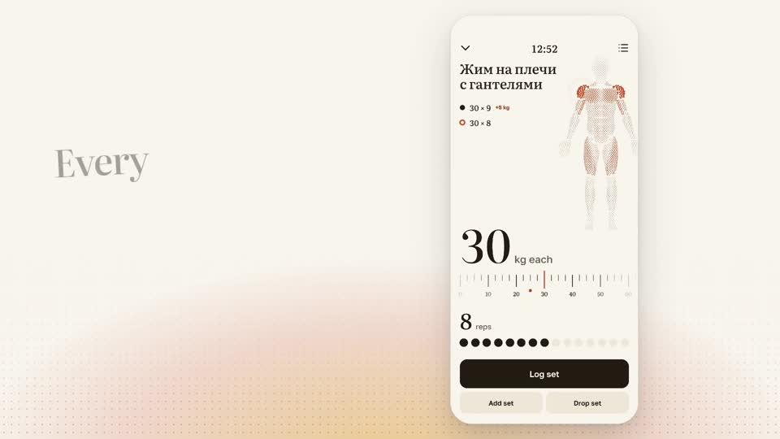

# LiftLog

LiftLog — нативный дневник силовых тренировок для iPhone. Во время тренировки выбираешь вес на линейке, отмечаешь повторы и нажимаешь **Log set**. Точка летит к мышце, которая работала в этом подходе. В конце тренировки дневник ставит на странице штамп с датой.

[Посмотреть или скачать промо · MP4 · 25 секунд · со звуком](https://github.com/nikitovih2004-ui/liftlog-showcase/releases/download/v1.0-showcase/liftlog.mp4). Ролик воссоздаёт интерфейс средствами HTML-анимации. Ниже — два снимка самого приложения с симулятора iPhone в демонстрационном режиме.

| Запись подхода | Завершение тренировки |
| --- | --- |
|  |  |

## Как это работает

- **Во время тренировки** приложение ведёт список подходов. Вес и повторы можно поправить, последнее действие — отменить.
- **После тренировки** календарь показывает, в какие дни были занятия. В разделе Progress можно проследить изменение рабочего веса для отдельного упражнения.
- **На телефоне** SwiftUI отвечает за экраны, а отдельный пакет LiftLogCore — за модель дневника, расчёты и локальное сохранение. Тренировка сохраняется на устройстве до отправки.
- **На экране** Metal рисует фигуру из тысяч точек. Каждая получает позицию, радиус и цвет. Фрагментный шейдер сглаживает край круга, чтобы фигура сохраняла полутоновый рисунок при повороте. [Исходный код шейдера](code/BodyDotsShader.swift)

## Как создавался проект

| Этап | Решение |
| --- | --- |
| Прототип | В веб-прототипе подобрали пропорции журнальной страницы и проверили, удобно ли набирать подход линейкой и точками повторов. |
| Нативный интерфейс | Экраны перенесли на SwiftUI, а фигуру — на Metal. Формулы в Swift сверяли тестами с реализацией прототипа в JavaScript. |
| Дневник | Экраны подключили к общей модели данных. Добавили локальный кэш и очередь сохранённых тренировок. |
| Доработка на iPhone | После проверок на устройстве добавили отмену и правку подхода, точный ввод с клавиатуры и просмотр прогресса за разные периоды. |

Автор проекта ставил задачи, выбирал поведение интерфейса и проверял его на iPhone. В разработке и ревью кода участвовали Claude и GPT.

## Авторы материалов

Музыка в промо — *Happy Beats / Business Moves Vol. 12*, Sascha Ende. Фрагмент трека сведён со звуковыми эффектами Kenney. [Sascha Ende](https://ende.app/) · [CC BY 4.0](https://creativecommons.org/licenses/by/4.0/) · [Kenney](https://kenney.nl/)

Контуры мышц для фигуры основаны на react-native-body-highlighter, © 2022 ELABBASSI Hicham. В интерфейсе использованы шрифты Literata и Golos Text. [Лицензия контуров](credits/body-outlines.txt)
